# Tableau Ossie Quickstart

> **Disclaimer:** This is a personal project. It is not an official Snowflake product and is not supported by Snowflake. It is provided as is, under the MIT license (see [LICENSE](LICENSE)). Tableau, Power BI, Microsoft Fabric, dbt and Snowflake are trademarks of their respective owners and are named here only to describe compatibility.

## Overview

Convert a Tableau workbook connected to the Snowflake TPC-H sample dataset through [Apache Ossie](https://github.com/apache/ossie), create a native Snowflake semantic view, and write a Tableau Data Source `.tds`. The main path runs live queries against `SNOWFLAKE_SAMPLE_DATA.TPCH_SF1`. The dbt Cloud Semantic Layer and Power BI steps are optional.

This page summarizes [tableau_ossie_quickstart.ipynb](tableau_ossie_quickstart.ipynb). The notebook is the runnable version: it uses in-process APIs and asserts on the live numbers.

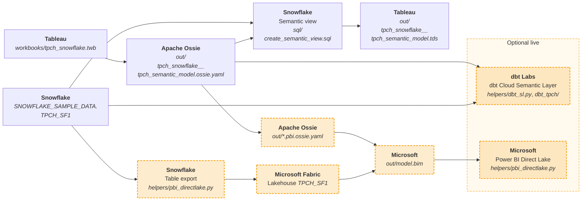

Worked files, in this folder:

- Workbooks: [tpch_snowflake.twb](workbooks/tpch_snowflake.twb), [lod.twb](workbooks/lod.twb)
- SQL: [sql/setup_snowflake.sql](sql/setup_snowflake.sql), [sql/teardown_snowflake.sql](sql/teardown_snowflake.sql), [sql/create_semantic_view.sql](sql/create_semantic_view.sql), [sql/metrics_snowflake.sql](sql/metrics_snowflake.sql), [sql/drop_snowflake.sql](sql/drop_snowflake.sql)
- Snowflake session: [connect.py](helpers/connect.py)
- dbt Cloud Semantic Layer: [dbt_sl.py](helpers/dbt_sl.py), [dbt_tpch/](dbt_tpch/)
- Power BI Direct Lake: [pbi_directlake.py](helpers/pbi_directlake.py)
- Environment template: [.env.example](.env.example)

### Prerequisites

- A checkout of [apache/ossie-converters](https://github.com/apache/ossie-converters) with this folder cloned
  inside it. The notebook finds the `tableau/`, `dbt/` and `microsoft/` converters at that checkout's root
  and the Apache Ossie core in its `ossie/` submodule. This folder is detected by its `helpers/connect.py` +
  `README.md` signature, so its name does not matter.

  > **The Tableau converter is not released yet.** It is in the open pull request
  > [apache/ossie-converters#82](https://github.com/apache/ossie-converters/pull/82), so these steps pin
  > that PR's head commit. A plain clone does not include it, hence the `fetch`.

  ```sh
  git clone https://github.com/apache/ossie-converters
  cd ossie-converters
  git fetch origin pull/82/head
  git checkout edb9f2400e694b0b19c12db061f63abfd7bc1599
  git submodule update --init ossie   # Apache Ossie core, pinned by the commit above

  git clone https://github.com/alexfrancisross/tableau-ossie-quickstart
  cd tableau-ossie-quickstart
  ```

  Run everything below from `tableau-ossie-quickstart/`. **Re-check this pin before relying on it**:
  once PR #82 merges or `ossie-converters` cuts a release, replace these steps with that supported source.
- A Python 3.11+ Jupyter kernel
- Tableau Desktop, to open [tpch_snowflake.twb](workbooks/tpch_snowflake.twb)
- A Snowflake account with `SNOWFLAKE_SAMPLE_DATA.TPCH_SF1`, a `[default]` entry in `~/.snowflake/connections.toml`, and one run of [sql/setup_snowflake.sql](sql/setup_snowflake.sql) as `ACCOUNTADMIN` (creates the least-privilege role `OSSIE_QS_ROLE`, the `OSSIE_TABLEAU` database and the dbt role grants). The notebook then runs as `OSSIE_QS_ROLE`
- Python packages installed in the kernel **before** you run the notebook (it does not install anything):

  ```sh
  pip install -r requirements.txt
  ```

  [requirements.txt](requirements.txt) pins the versions this quickstart was tested with.

  `ossie` and `ossie_tableau` come from the Ossie clone through `sys.path`; do not pip-install them. `pyarrow>=21` is needed for the optional Power BI Parquet export, and `metricflow` for the optional dbt conversion.
- Optional, dbt Cloud: a Starter+ project (`ossie-qs`) git-connected with subdirectory `dbt_tpch`, a deployment environment, Semantic Layer credentials, and a job that runs `dbt run --select stg_* metricflow_time_spine` then `dbt parse`
- Optional, Power BI: a service principal that is a Fabric workspace contributor with `Lakehouse.ReadWrite.All`

### What You'll Learn

- How `ossie-tableau convert` writes Ossie YAML and a classified `.loss.json`, and how to read its summary line
- How native `CREATE SEMANTIC VIEW` queries `total_revenue` and `revenue_per_customer` on the TPC-H sample data
- How Snowflake exports a credential-free `.tds` from the semantic view
- What convert records as a loss for viz-dependent `INCLUDE` / `EXCLUDE` LODs
- Optionally: the same metrics through the dbt Cloud Semantic Layer and Power BI Direct Lake

### What You'll Build

- `out/*.ossie.yaml` plus a `.loss.json` per datasource (under this folder)
- Snowflake semantic view `OSSIE_TABLEAU.OSSIE_QS.SV_01_TPCH`
- A Tableau Data Source `.tds`
- Optionally: `semantic_manifest.json`, a Power BI sibling YAML, `out/model.bim`, Fabric lakehouse `ossie_qs_lh`, and semantic model `ossie-qs-tpch`

## 1. Setup

First, as `ACCOUNTADMIN`, edit the three `SET` lines in [sql/setup_snowflake.sql](sql/setup_snowflake.sql) (user, warehouse, dbt role) and run it once, in Snowsight or with `snow sql -c <connection> --role ACCOUNTADMIN -f sql/setup_snowflake.sql`. It is idempotent.

Then open the notebook from `tableau-ossie-quickstart/` (the `ossie-converters` checkout root also works):

```sh
jupyter notebook tableau_ossie_quickstart.ipynb
```

Snowflake credentials come only from the `[default]` entry in `~/.snowflake/connections.toml` (it must be the user you pass to the setup script). For the optional dbt Cloud and Power BI steps, copy `.env.example` to `.env` in this folder and fill it in.

```sh
cp .env.example .env
```

- **Snowflake (main path):** nothing in `.env`. The `[default]` entry in `connections.toml` supplies credentials and warehouse; the notebook always uses `OSSIE_QS_ROLE`.
- **dbt Cloud (optional):** `DBT_CLOUD_URL`, `DBT_CLOUD_TOKEN`, and `DBT_CLOUD_PROJECT` (default `ossie-qs`). Leave them blank to skip the live step.
- **Power BI (optional):** `PBI_TENANT_ID`, `PBI_CLIENT_ID`, `PBI_CLIENT_SECRET`, and `PBI_WORKSPACE_ID`. Leave them blank and the notebook checks the DAX locally, then skips Fabric. `OSSIE_QS_TPCH_FILTER=YYYY-MM` exports one `L_SHIPDATE` month instead of full SF1.

`.env` is gitignored; never commit it.

The known live values on SF1 are **total_revenue = 218102223885.0001** and **revenue_per_customer = 2181109.4832293302**.

## 2. Open the Tableau workbook (Optional)

Open [tpch_snowflake.twb](workbooks/tpch_snowflake.twb) in Tableau Desktop. Convert reads the Tableau XML and does not need a live connection; this step is so you can see the source model. The sheet already has the TPC-H tables and the measures `total_revenue` / `revenue_per_customer`.

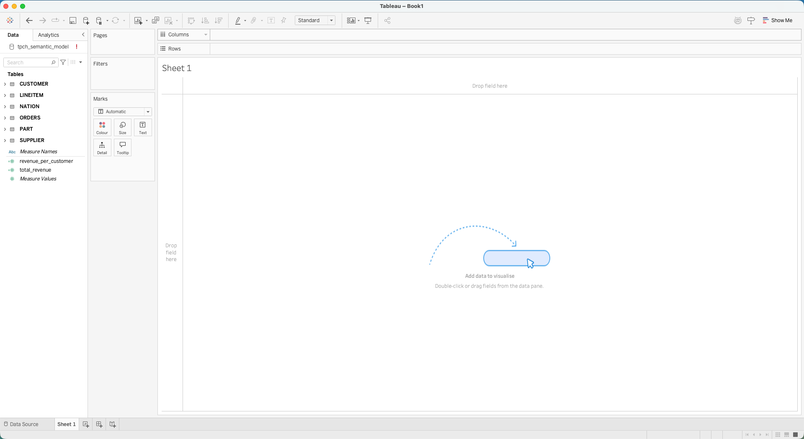

The stored Snowflake connection uses the placeholder host `account.snowflakecomputing.com`. To query live, use Data > Edit Connection, replace Server with your account host and authenticate.

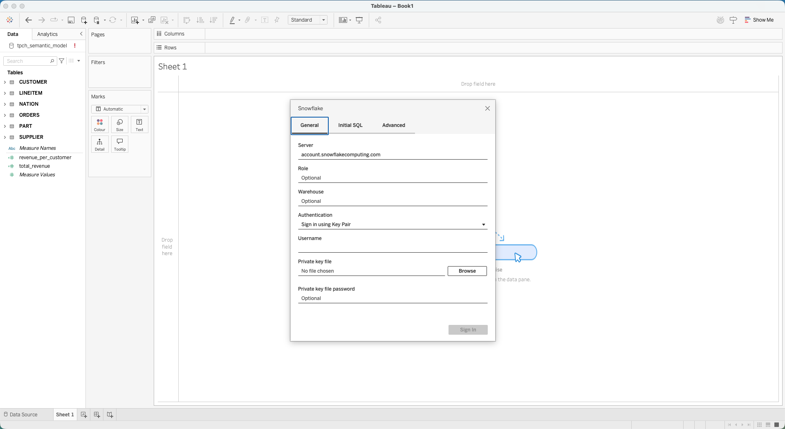

The data source is database `SNOWFLAKE_SAMPLE_DATA`, schema `TPCH_SF1`. The model is `LINEITEM` to `ORDERS` / `PART` / `SUPPLIER`, and `ORDERS` to `CUSTOMER` to `NATION`.

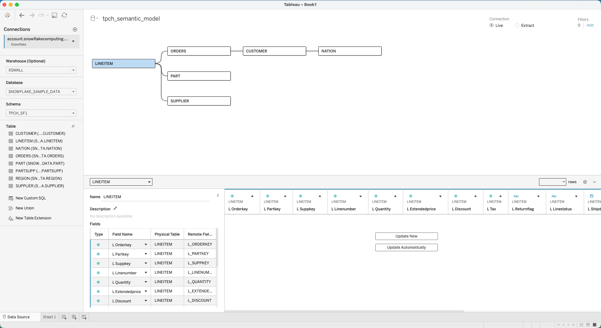

## 3. Workbook to Ossie

`ossie-tableau convert` reads the workbook as XML and writes Ossie YAML plus a classified `.loss.json` under `out/`. The stem is `<workbook>__<datasource>` (`tpch_snowflake__tpch_semantic_model`). The notebook calls the same code in-process; the CLI equivalent is:

```sh
uv run --project ../tableau ossie-tableau convert \
  workbooks/tpch_snowflake.twb -o out
```

Expected summary line:

```
OK   tpch_snowflake__tpch_semantic_model: {'datasets': 6, 'fields': 54, 'relationships': 5, 'metrics': 2, 'unconverted_calcs': 1, 'row_level_fields': 1} losses=3
```

- **`OK <stem>`**: the output file stem. The `.ossie.yaml` and `.loss.json` are written under that name in `out/`.
- **`datasets: 6`**: `LINEITEM`, `ORDERS`, `CUSTOMER`, `NATION`, `PART`, `SUPPLIER`.
- **`fields: 54`**: columns carried over as Ossie fields, plus the row-level `customer_label`.
- **`relationships: 5`**: the TPC-H joins.
- **`metrics: 2`**: `total_revenue` and `revenue_per_customer`.
- **`unconverted_calcs: 1`**: the FIXED LOD `customer_lifetime_revenue` is parked (kind `lod`). It sums an expression across `LINEITEM` and `CUSTOMER`, which convert doesn't translate. A simpler single-table `{FIXED [d]: SUM([x])}` is emitted with window SQL instead (kind `lod_translated`).
- **`row_level_fields: 1`**: `customer_label`.
- **`losses=3`**: one warning (`lod`) plus two info losses (`relationship_cardinality`, `semantic_values`). Nothing is dropped silently.

## 4. Snowflake semantic view

The notebook runs [sql/create_semantic_view.sql](sql/create_semantic_view.sql) to create [`SV_01_TPCH`](https://docs.snowflake.com/en/sql-reference/sql/create-semantic-view) in `OSSIE_TABLEAU.OSSIE_QS`, then queries `total_revenue` and `revenue_per_customer` and asserts the live values above. The view stays until the cleanup step.

> **Note:** Do not use [`SYSTEM$CREATE_SEMANTIC_VIEW_FROM_OSSIE_YAML`](https://docs.snowflake.com/en/sql-reference/stored-procedures/system_create_semantic_view_from_ossie_yaml) on the converter output. The converter writes Ossie `0.2.0.dev0`. As of 2026-10-27, Snowflake accepts `0.1.1` only and has no Ossie 2.0.0 support yet (`Unsupported OSI specification version '0.2.0.dev0'`). `0.2.0.dev0` is not compatible until Snowflake lists that version and accepts these metric expressions.

## 5. Semantic view to Tableau TDS

[`SYSTEM$EXPORT_TDS_FROM_SEMANTIC_VIEW`](https://docs.snowflake.com/en/sql-reference/functions/system_export_tds_from_semantic_view) (Preview) writes a `.tds` that points at `SV_01_TPCH` as one flat table. Metrics use `AGG()`, there are no joins, and the file has no credentials.

```sql
SELECT SYSTEM$EXPORT_TDS_FROM_SEMANTIC_VIEW('OSSIE_TABLEAU.OSSIE_QS.SV_01_TPCH');
```

Reading the output:

- **`OK <stem>.tds`**: the `.tds` is written to `out/` under the same stem as the Ossie YAML.
- **`relationships=0`**: the export is one flat table over `SV_01_TPCH` with no Tableau joins. Metrics use `AGG()`, so Tableau pushes them to the semantic view.
- **Assertions**: the notebook checks that the XML starts with `<?xml`, contains `SV_01_TPCH` and `TOTAL_REVENUE` (Snowflake uppercases the metric; the visible caption is `Total Revenue`), wraps it in `AGG(%1)`, and has no `password`, `token` or `secret` attribute. Connection details come from the live session.

## 6. What convert records as a loss

[lod.twb](workbooks/lod.twb) holds two viz-dependent LODs on `LINEITEM`: `{INCLUDE [L_SHIPMODE]: SUM([L_EXTENDEDPRICE])}` and `{EXCLUDE [L_RETURNFLAG]: SUM([L_QUANTITY])}`.

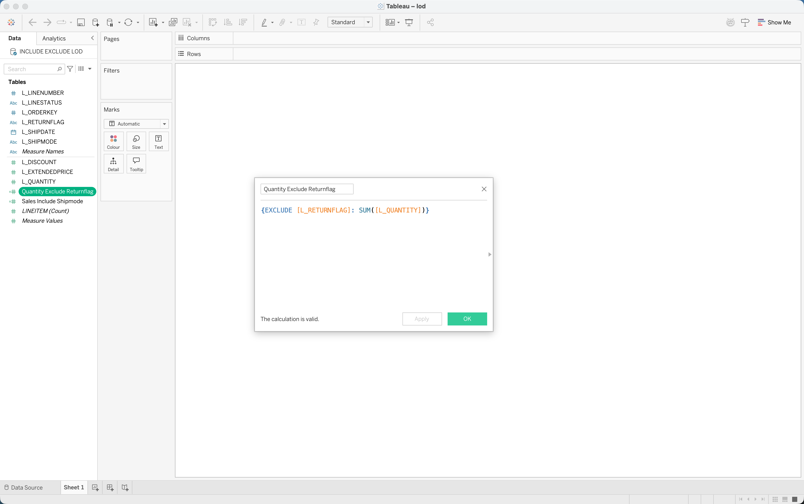

Convert keeps both as metrics, attaches window SQL, and writes a non-empty `.loss.json`. Kind `sql_unreconciled` means the SQL is table-wide `OVER`, not Tableau Compute Using. The summary shows `metrics: 2`, `unconverted_calcs: 0`, `losses=2`: the calcs are metrics, not parked (contrast the parked `{FIXED}` `customer_lifetime_revenue` in section 3), and convert still records a loss for each.

- **`Sales_Include_Shipmode` (Snowflake)**: `SUM((L_EXTENDEDPRICE)) OVER (PARTITION BY (L_SHIPMODE))`. The EXCLUDE sibling is `SUM((L_QUANTITY)) OVER ()`.
- Tableau EXCLUDE means viz grain minus that dimension; convert emits a table-wide window. That SQL is best-effort, not a MetricFlow or DAX translation. Section 7 still deploys `total_revenue` / `revenue_per_customer` only.

## 7. Optional: dbt Cloud and Power BI

### dbt Cloud Semantic Layer

1. **MetricFlow Semantic Interface (MSI) convert.** The notebook converts the Ossie YAML to an MSI manifest (`ossie_dbt`) and writes `out/semantic_manifest.json`, so you can see the metric names the converter emitted. It asserts `total_revenue` and `revenue_per_customer` are present. That JSON is not a dbt project.
2. **Snowflake.** Create a service user for dbt Cloud (the notebook uses `DBT_CLOUD_SVC` and a key pair). Its default role needs `SELECT` on `SNOWFLAKE_SAMPLE_DATA.TPCH_SF1`; pass that role as `dbt_role` to `sql/setup_snowflake.sql`, which creates `OSSIE_TABLEAU.OSSIE_QS_DBT` and grants it `CREATE TABLE` / `CREATE VIEW` on that schema and on future schemas (see `DESC USER` for the default role). Set `DBT_CLOUD_SNOWFLAKE_USER` and `DBT_CLOUD_SNOWFLAKE_ROLE` in `.env` and Step 1 checks that grant. The dbt Cloud environment must target database `OSSIE_TABLEAU`, schema `OSSIE_QS_DBT`.
3. **dbt Cloud project.** Create a new dbt Cloud project called `ossie-qs` and git-connect this repo with subdirectory `dbt_tpch`.
4. **Environment.** Add a Snowflake connection profile and credentials for the dbt Cloud service user from step 2, then create a deployment environment named `OSSIE_QS_SF`.

   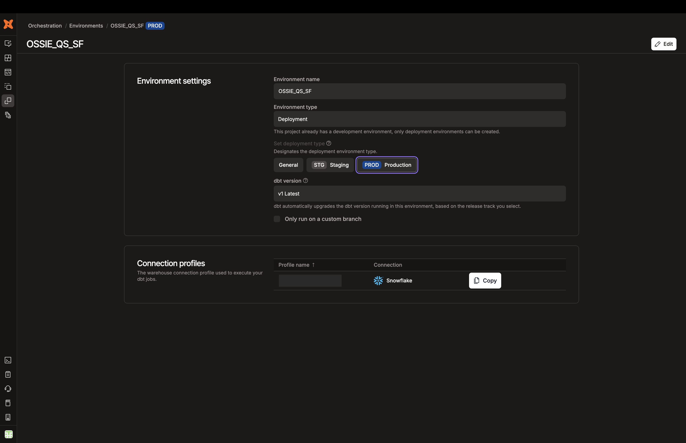

   **5. Create the job `OSSIE_QS_SF_PARSE`** in the `OSSIE_QS_SF` environment with these two commands, in order:

   - `dbt run --select stg_* metricflow_time_spine` builds in `OSSIE_TABLEAU.OSSIE_QS_DBT` the three staging views (`stg_customer`, `stg_lineitem`, `stg_orders`) over the TPC-H sample tables and the `metricflow_time_spine` table of daily dates. The semantic models read the staging views, and MetricFlow uses the time spine for time-based queries. This is the only step that writes to Snowflake, which is why the dbt role needs `CREATE TABLE` / `CREATE VIEW` on that schema.
   - `dbt parse` validates the semantic models and metrics (`total_revenue`, `customers`, `revenue_per_customer`) and writes the `semantic_manifest.json` the Semantic Layer reads. No data is moved and metrics are not materialized: each query compiles to SQL over the views at request time.

   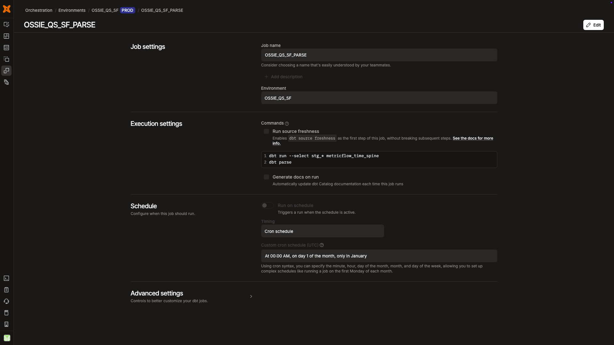

   **6.** Save and run the job and verify all steps have run successfully.

   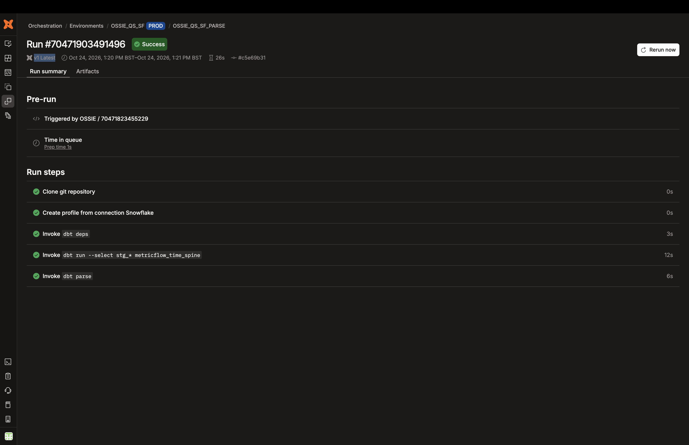

   **7. Studio.** Once 4c succeeds, dbt Cloud Studio shows the MetricFlow metrics (`total_revenue`, `customers`, `revenue_per_customer`) in `models/metrics/tpch.yml`.

   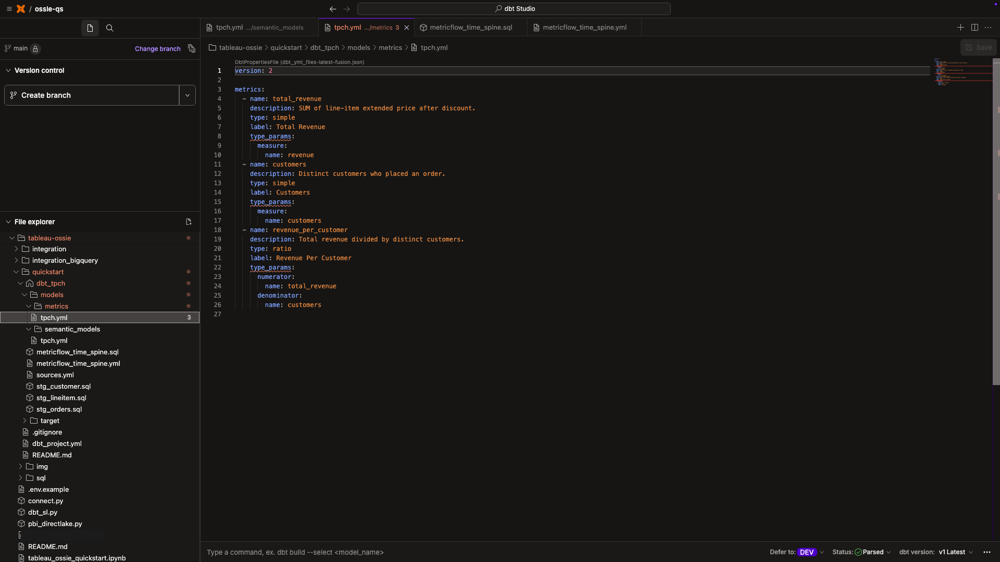
5. **8.** **Semantic Layer credentials.** Job credentials and Semantic Layer credentials are different objects. A green job run does not mean GraphQL can reach Snowflake through the dbt Semantic Layer. Edit the `Analytics Credentials` in the `ossie-qs` project and point them at the same Snowflake user, role, warehouse and key pair from step 2.
6. 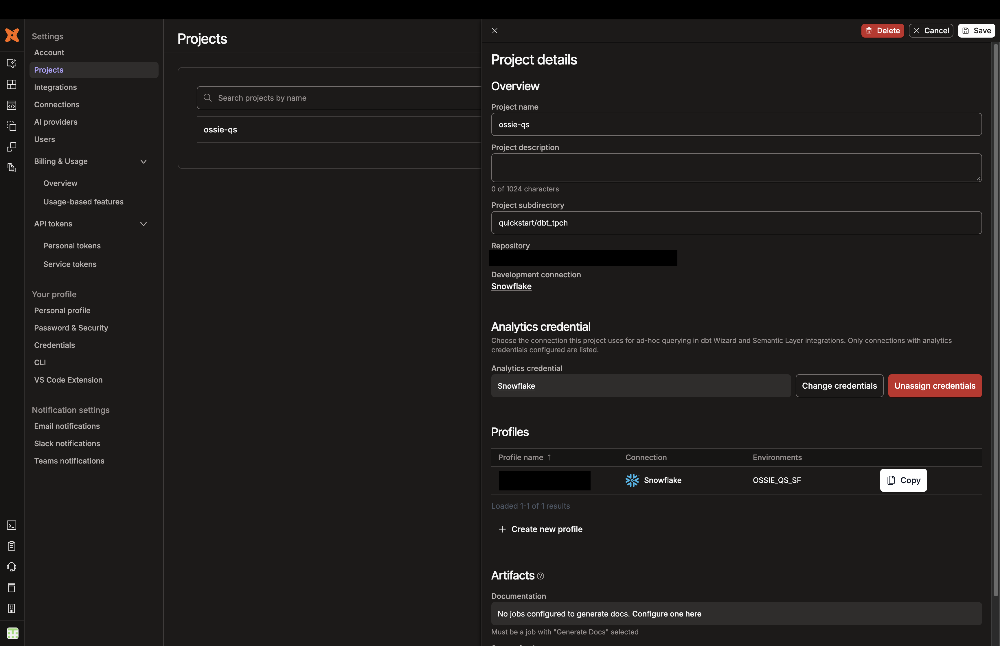**9. Notebook step. Set `DBT_CLOUD_URL`, `DBT_CLOUD_TOKEN` and `DBT_CLOUD_PROJECT=ossie-qs`. `dbt_sl.deploy_and_query` triggers the dbt Cloud job and checks `total_revenue` / `revenue_per_customer` over GraphQL. Without them it skips. Tokens are never printed.**
7. ****10. GraphQL explorer.** The notebook's last 7a cell prints your explorer URL (from `DBT_CLOUD_URL` via `dbt_sl.sl_graphql_url`), the auth header, your deployment `environmentId` and three GraphQL snippets to paste in. Use the header `{"Authorization": "Bearer <DBT_CLOUD_TOKEN>"}`, then list metrics:**

   **`metricsPaginated` lists `customers` (SIMPLE), `revenue_per_customer` (RATIO) and `total_revenue` (SIMPLE):**

   **Run both metrics with `createQuery`:**

   **Then poll `query` with the returned `queryId` until `status` is `SUCCESSFUL`:**

   **`jsonResult` returns the SF1 metrics (`total_revenue` **218102223885.0001**, `revenue_per_customer` **2181109.4832293303**):**

### Power BI (Fabric Direct Lake)

1. **Sibling YAML.** `ossie_microsoft` only translates `SUM` over a single column, so [pbi_directlake.py](helpers/pbi_directlake.py) adds `DISCOUNTED_PRICE` and `ORDER_CUSTKEY` and rewrites the two metrics into a sibling `.pbi.ossie.yaml`. The original YAML is unchanged.
2. **Environment.** Set the four `PBI_*` variables. Without them the cell checks the DAX, writes `out/model.bim`, and skips Fabric. `LINEITEM` has 6,001,215 rows; set `OSSIE_QS_TPCH_FILTER=YYYY-MM` for a one-month extract.
3. **What the cell does.** It find-or-creates lakehouse `ossie_qs_lh`, exports the six TPC-H tables from Snowflake (`LINEITEM` is joined to `ORDERS` to add `ORDER_CUSTKEY`, then sent in chunks of 1,000,000 rows by default), writes Direct Lake `out/model.bim`, deploys `ossie-qs-tpch`, and refreshes it (`DirectLakeFraming`). Each run uploads to a fresh `Files/tpch_<timestamp>` folder and replaces the `TPCH_SF1` tables. If the load fails, the model is not updated. Deleting an existing semantic model during redeploy requires `PBI_ALLOW_DELETE=1`.
4. **What it checks.** `revenue_per_customer` is `DIVIDE(SUM('LINEITEM'[DISCOUNTED_PRICE]), DISTINCTCOUNTNOBLANK('LINEITEM'[ORDER_CUSTKEY]))`. The cell asserts that DAX. When Fabric allows `executeQueries` it also prints and asserts the metrics (`total_revenue=218102223885.0001` / `revenue_per_customer=2181109.4832293302`); when denied (`PowerBINotAuthorizedException`), it prints `model was not queried`. The deploy did not fail, so open the printed link and compare the numbers yourself. To enable it, a Fabric admin must allow service principals to use Power BI APIs and the Dataset Execute Queries REST API, and the service principal needs Build on `ossie-qs-tpch`.
5. **Expected warnings.** `ossie_microsoft` drops Tableau `custom_extensions`, display labels have no TMSL counterpart, measures with no home table land on `CUSTOMER`, and measure data types are inferred from DAX. The notebook prints these grouped with counts.
6. **Reading the output.**
   - `rewrote out/...pbi.ossie.yaml`: the sibling YAML, with SQL expressions reformatted for the converter (`SUM(DISCOUNTED_PRICE)`).
   - `loaded TPCH_SF1.LINEITEM rows 6001215`: the table is in the lakehouse; row counts are a sanity check against SF1.
   - `measures [...]` and `wrote out/model.bim`: the two DAX measures, and the TMSL model with Direct Lake partitions on the lakehouse tables.
   - `skipped Power BI`: `PBI_*` is unset. `model.bim` was written and the DAX checked; Fabric and Snowflake were not called.
   - `updated ossie-qs-tpch <id>` and `refresh DirectLakeFraming completed`: the semantic model was deployed (or updated in place) and Direct Lake reframed onto the loaded tables.
   - `open https://...`: the deployed semantic model in Fabric.

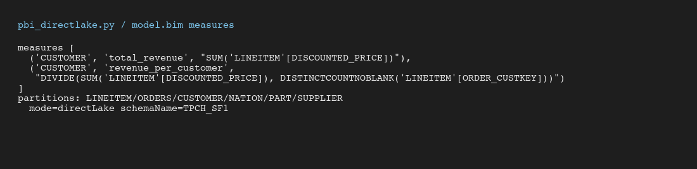

Open the printed link to reach the Power BI semantic model published to Fabric as `ossie-qs-tpch`. Model view of the converted tables and relationships (note the Direct Lake storage mode):

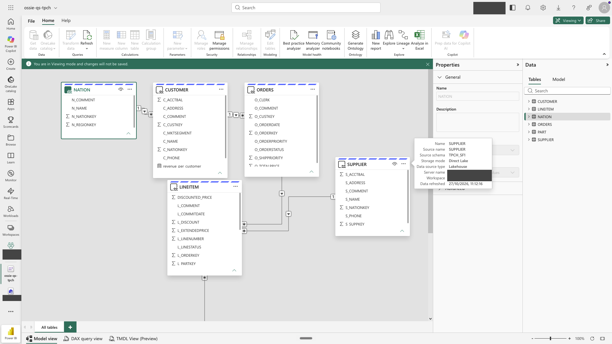

A report visual (`total_revenue` by `N_NAME`, showing `total_revenue=218102223885.0001` / `revenue_per_customer=2181109.4832293302`) built on the semantic model:

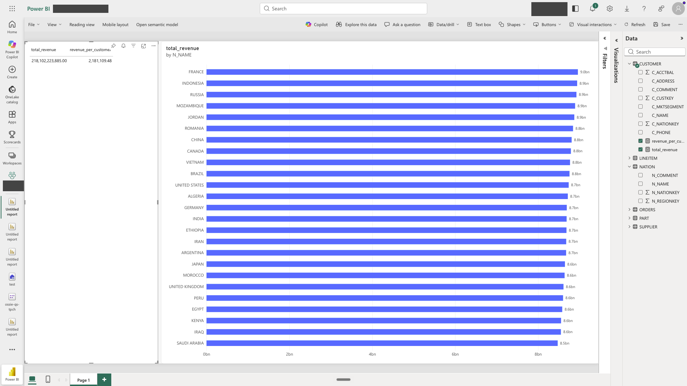

The Power BI numbers come from the lakehouse export, not a live Snowflake connection.

## 8. Cleanup

The notebook's cleanup cell is commented out so nothing is dropped by accident. Uncomment it to run. It runs as `OSSIE_QS_ROLE` and drops the schemas `OSSIE_TABLEAU.OSSIE_QS` (including the semantic view) and `OSSIE_TABLEAU.OSSIE_QS_DBT`. The database, role, grants and the local files in `out/` stay. For a full reset run [sql/teardown_snowflake.sql](sql/teardown_snowflake.sql) and then the setup script again. If `PBI_*` is set it also deletes the Fabric semantic model `ossie-qs-tpch` and lakehouse `ossie_qs_lh` (with its tables and uploaded files). dbt Cloud objects (project, environment, job) are not deleted; remove them in the dbt UI.

**Greenfield rerun:** after cleanup, restart the kernel and run all cells from Step 1. Step 1 recreates the schemas (future grants restore the dbt role's access); the existing dbt Cloud project, environment and job are reused.

## Related projects

- [Apache Ossie converters](https://github.com/apache/ossie-converters), the home of the converter packages this quickstart uses.
- [Tableau converter pull request #82](https://github.com/apache/ossie-converters/pull/82), which adds the Tableau converter (`ossie_tableau`).
- [Apache Ossie](https://github.com/apache/ossie), the specification.

## Support and contributing

This is a sample, provided without support. Issues and pull requests are welcome but may not get a response. Report security problems privately as described in [SECURITY.md](SECURITY.md).

## License

[MIT](LICENSE). Copyright (c) 2026 Alex Ross.

## Conclusion

You took the TPC-H sample data around the full loop: queried it live in Snowflake, converted a Tableau workbook to Ossie YAML, created a semantic view, and exported a `.tds` from it. The LOD example showed convert writing a non-empty `.loss.json`: `{INCLUDE}` / `{EXCLUDE}` stay metrics (`unconverted_calcs: 0`) and still record `sql_unreconciled` because the window SQL is table-wide, not Tableau Compute Using. The main convert's `lod` loss is the parked FIXED calculation. If you ran the optional section, you also deployed the TPC-H metrics to the dbt Cloud Semantic Layer and published the model to Power BI as Direct Lake on a Fabric export of those tables. One thing to know: the Power BI numbers come from that export, not from a live Snowflake DirectQuery connection.
